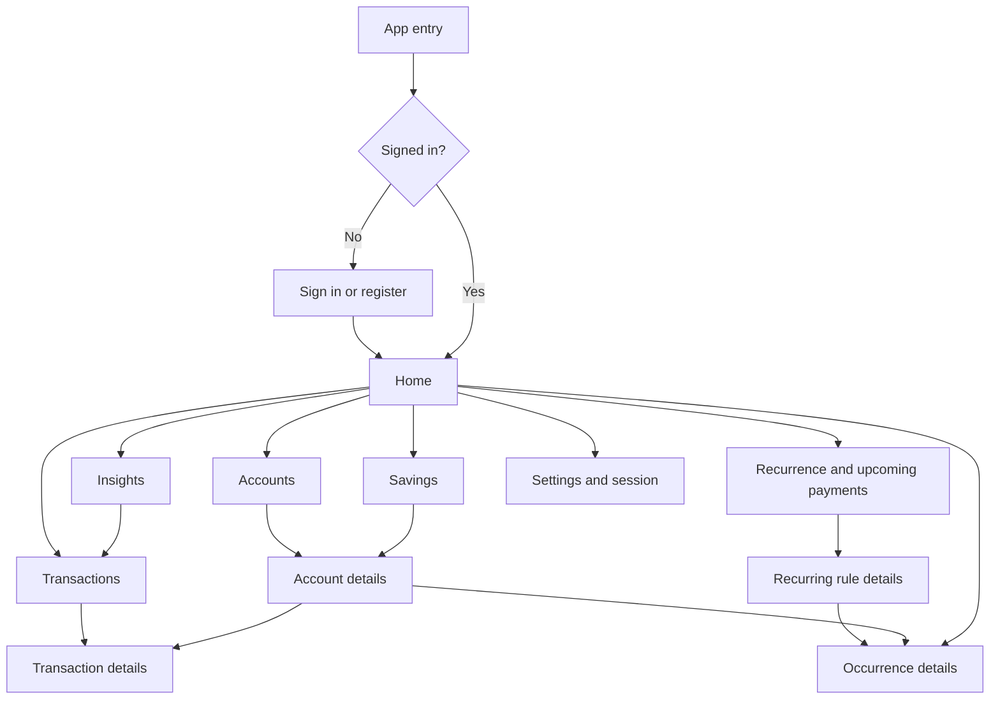
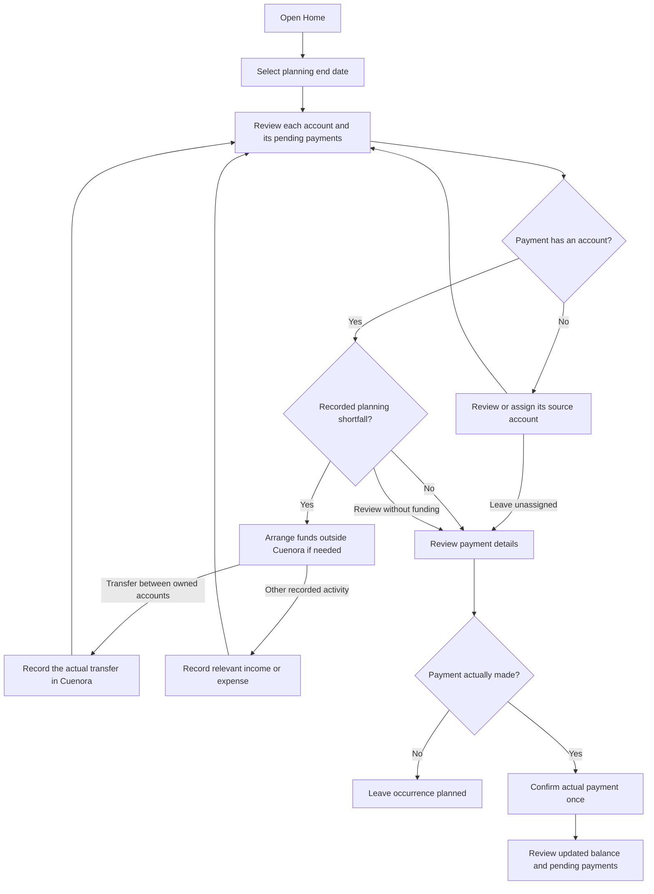

# Navigation and primary user flows

**Roadmap:** P01.05 · **Status:** Defined initial proposal · **Date:** 2026-10-22

Cuenora's navigation starts with recorded balances and upcoming payments, then
connects them to the actions that keep those records useful. This document defines
logical destinations and user journeys for the MVP, not implemented screens.
It is the starting point for P01.06–P01.08 wireframes; tab counts, menus, and native
presentation remain decisions for those tasks.

## Navigation map

Home is the overview after sign-in. Accounts, Transactions, Recurrence, Savings,
and Insights are reachable destinations, not a requirement for six navigation tabs.
Savings is a focused view of existing accounts, not a separate store of money.

| Destination | Main question | Contents and actions |
| --- | --- | --- |
| Home | Where is my money, and which account needs attention? | Recorded balances by currency, upcoming payments through a selected date, per-account planning differences, and entry points to record activity. |
| Accounts | What is recorded in this account? | Normal and savings accounts, creation, posted activity, and pending payments associated with an account. |
| Transactions | What happened, and when? | Dated income, expenses, and transfers; filters including accountless entries; details, recording, and auditable corrections. |
| Recurrence | What is expected, and what has been paid? | Recurring rules, planned occurrences, source accounts, due dates, and confirmation of actual payments. |
| Savings | What is saved, projected, or actually credited? | Savings balances, optional interest terms and rate periods, separate forecasts, and actual interest receipts. |
| Insights | What came in and went out? | Period and category breakdowns, income, expenses, net flow, and savings, separately by currency. Links to the records behind a breakdown. |
| Settings and session | How do I access and leave my session? | Access to session controls, including sign-out. This destination does not add deferred localization or export features to the MVP. |

Return from a detail or successful form to its originating view, with the relevant
account, period, and filters retained where applicable. Account details opened
from Savings refer to the same account and activity shown under Accounts.

## Core journey: prepare an account for a payment

**Stories:** US-01–US-04, US-06, US-08.

The shortfall is a planning comparison using recorded data, not a prediction of
bank acceptance. Transfers are optional responses to a shortfall, not compulsory
steps or financial advice. Recording a transfer does not move funds at a bank.
The user can leave this journey at any point; reviewing a payment never posts it.
Payments without an account remain visible rather than disappearing from planning.

## Primary flows

Every save below means validated, confirmed persistence. Shared failure and
cancellation paths are specified after the table.

| Flow / story | Entry and steps | Result and alternate path |
| --- | --- | --- |
| F01 — Access and first account; US-01 | Open app → sign in or register if needed → Home → Add account → choose normal or savings, currency, and opening balance → review → save. | Account appears with an opening movement, not income. Empty Home offers creation without blocking accountless recording. Existing users return to their overview. |
| F02 — Record income or expense; US-05, US-09 | Home, Transactions, or Account details → choose income or expense → enter amount, currency, business date, and applicable description/category → choose an account or explicitly leave it unassigned → review → save. | One report entry; only an assigned account has a balance effect. Ordinary income cannot target savings. With no accounts, recording without one remains available. |
| F03 — Assign or correct an entry; US-05, US-09 | Transactions → filter or select an entry → details → edit or change/remove account assignment → review the change → save. | Preserve the original report item and business date unless the user explicitly changes the date. Reverse the old account effect and apply the new one together, with auditable history. Invalid ownership, currency, or savings-income assignment changes nothing. |
| F04 — Record a transfer; US-04 | Home, Transactions, or Account details → Record transfer → choose distinct owned source/destination accounts and business date → enter amounts → review both account effects → save. | One operation with two atomic movements and no income/spending. Same-currency amounts match; cross-currency transfers require actual sent/received amounts and allow an optional reference rate. Fewer than two suitable accounts leads to account creation or cancellation. |
| F05 — Schedule an expense; US-02 | Recurrence → Add recurring expense → enter amount, currency, schedule, and optional source account → review → save → inspect occurrences. | Occurrences remain planned. Unassigned occurrences are labeled; no posted balance or spending changes. Detailed schedule policies remain owned by Phase 07. |
| F06 — Confirm a payment; US-06 | Home, Account details, or Recurrence → occurrence details → review actual payment information and optional source account → confirm only after payment happened → save. | Post the expense once and remove that occurrence from pending commitments. No assigned account means a report effect without a movement. Unpaid or overdue occurrences remain planned; other occurrences are unaffected. |
| F07 — Review spending and planning; US-03, US-07, US-08 | Home → choose planning end date → inspect account-specific commitments; or Insights → select period/currency and category where relevant → inspect totals → open contributing transactions. | Recorded balances, pending payments, and realized net flow remain distinct. Reports include accountless entries and exclude transfers/openings from income and spending. No implicit combined currency total or guaranteed safe-to-save amount. |
| F08 — Savings and interest; US-10 | Savings → select a savings account → review posted balance → optionally configure interest terms and effective-dated rate periods → inspect a separately labeled forecast when supported; or record an actual interest receipt with amount, business date, and receiving account → review → save. | Savings works without interest. Incomplete or unsupported calculation terms explain why no forecast is available without blocking actual receipt recording. A confirmed receipt credits only its receiving account once, even when different from the savings account. Rate changes preserve prior periods and posted receipts. |

New savings contributions after opening use F04. F08 does not offer ordinary
income as a shortcut. Forecast interest never becomes credited just because its
expected payout date arrives. Account creation is reusable from Accounts and
Savings as well as onboarding; it does not create two versions of the same account.

## Shared alternate and recovery paths

| Situation | User path and required outcome |
| --- | --- |
| Empty data or filtered results | Explain whether no records exist or the current filter has no matches. Offer the relevant create action or filter adjustment; do not imply an account is required for accountless entries. |
| Cancel or go back before submission | Return without creating or changing financial records. If the form has unsaved changes, allow the user to keep editing or discard them. This does not imply durable drafts. |
| Invalid input | Keep entered values visible, identify the field and correction needed, and let the user resubmit. Do not report success or apply partial financial effects. |
| Load failure or offline access | Explain that current data could not be loaded and offer retry when available. Do not show a loading failure as a zero balance or promise offline writes/synchronization. |
| Repeated submission | A confirmed write has one result; a transfer never leaves only one account changed. Retried confirmation must not duplicate an occurrence or interest receipt. |
| Unknown write outcome | Explain that completion could not be confirmed. Resolve the original operation's status or retry under the implemented idempotency contract before claiming a result; do not direct the user to create a second operation. Exact recovery controls require the later API/client contract. |
| Session expires or access is denied | Request sign-in when applicable or explain unavailable access without exposing another user's data. Resolve any uncertain submitted operation after authentication; do not silently resubmit it as a new operation. |
| Correct a posted record | Open the existing operation and use its supported auditable correction/reversal path. Do not present deletion of posted movements as routine cleanup. Detailed controls follow the later accounting specifications. |

## Traceability and walkthrough checks

| Stories | Flows | Existing acceptance examples |
| --- | --- | --- |
| US-01 | F01, core journey | EX-01 |
| US-02, US-03, US-06 | F05–F07, core journey | EX-08 |
| US-04 | F04, core journey | EX-05–EX-07 |
| US-05, US-09 | F02–F03 | EX-02–EX-04, EX-10 |
| US-07, US-08 | F07 | EX-01–EX-06, EX-08, EX-10 |
| US-10 | F08 | EX-09–EX-10 |

Walk through these paths against the [worked examples](worked-examples.md)
before drawing screens:

1. With no accounts, reach both first-account creation and accountless recording.
2. Find a shortfall in a specific account despite sufficient money elsewhere,
   record a real transfer, and confirm a later payment without double posting.
3. Record without an account, find the entry, and assign or reassign it without
   duplicating report totals or allowing ordinary income into savings.
4. Keep SEK/EUR/USD separate, including a transfer with different sent/received
   currencies and an optional rate.
5. Keep forecast interest separate from actual receipts and credit only the
   selected receiving account.
6. Follow cancellation, failed loading, invalid input, and unknown write outcome
   paths without inventing successful persistence.

These are documentation walkthrough criteria, not executed application tests.
P01.05 is complete as a navigation and flow definition; final layouts and native
controls belong to the wireframes, not this map. Calculation boundaries (P09.01),
interest conventions (P08.01), and API recovery contracts remain implementation
prerequisites rather than decisions implied by the diagrams.

## References

- [Prioritized user stories](user-stories.md) and [PRD](prd.md)
- [Financial glossary](glossary.md) and [verbal identity](verbal-identity.md)
- [Accountless entries](accountless-entries.md), [transfers](currencies-and-transfers.md),
  and [savings](savings.md)
